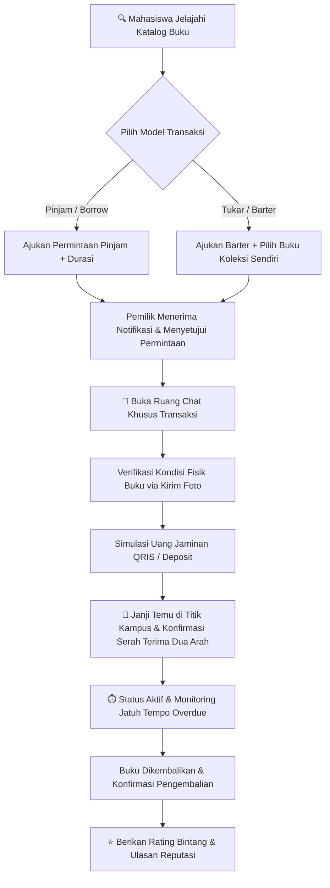

<div align="center">

  <h1>📖 Librava</h1>
  <p><strong>Peer-to-Peer Academic Book Sharing & Barter Platform for University Students</strong></p>
  <p><em>Solusi digital kolaboratif peminjaman dan pertukaran buku teks akademik antar mahasiswa kampus.</em></p>

  <br/>

[](https://flutter.dev)
[](https://dart.dev)
[](https://nodejs.org)
[](https://www.typescriptlang.org)
[](https://expressjs.com)
[](https://www.prisma.io)
[](https://supabase.com)
[](test)
[](LICENSE)

  <br/><br/>

[📌 Tentang](#-tentang-librava) •
[🔄 Alur Transaksi](#-alur-transaksi-p2p) •
[🚀 Fitur Utama](#-fitur-utama) •
[🏗️ Arsitektur](#-arsitektur--struktur-direktori) •
[🛠️ Tech Stack](#-tech-stack) •
[📡 API Endpoints](#-spesifikasi-api-endpoints) •
[⚡ Panduan Instalasi](#-panduan-instalasi--menjalankan-proyek) •
[🧪 QA & Pengujian](#-pengujian--kualitas-kode-quality-assurance) •
[🔑 Akun Demo](#-akun-pengujian-siap-pakai) •
[👥 Tim](#-tim-pengembang)

</div>

---

## 📌 Tentang Librava

**Librava** adalah platform peer-to-peer (P2P) inovatif yang dirancang khusus untuk mahasiswa dan civitas akademika universitas (**Telkom University**). Librava memfasilitasi pertukaran (*barter*) dan peminjaman (*borrow*) buku teks kuliah, referensi riset, maupun bacaan literasi secara aman, terorganisir, dan transparan.

> [!NOTE]
> Proyek ini dikembangkan di bawah naungan **Advanced Software Engineering (ASE) Laboratory 2026** di Telkom University untuk mengatasi tantangan aksesibilitas buku akademik dan mendorong sirkulasi literasi berkelanjutan di lingkungan kampus.

### 💡 Masalah yang Diselesaikan:
* 💸 **Tingginya Biaya Buku Teks**: Mahasiswa sering mengeluarkan biaya tinggi untuk buku yang hanya digunakan aktif selama 1 semester.
* 📉 **Buku Menganggur (*Idle Assets*)**: Koleksi buku kuliah menumpuk di rak mahasiswa senior tanpa pemanfaatan lanjutan.
* 🤝 **Risiko Peminjaman Manual**: Peminjaman informal sering berisiko buku hilang, rusak, atau terlambat dikembalikan tanpa komitmen jaminan yang jelas.
* 📍 **Koordinasi Terfragmentasi**: Percakapan terpecah di berbagai aplikasi perpesanan tanpa pelacakan status transaksi yang terstruktur.

---

## 🔄 Alur Transaksi P2P

Librava mengintegrasikan alur peminjaman dan pertukaran buku berbasis kepercayaan (*trust-based P2P engine*) dengan perlindungan deposit dan konfirmasi serah terima dua arah:



---

## 🚀 Fitur Utama

### 1. 🔄 Mesin Transaksi P2P (Pinjam & Barter)
* **Model Transaksi Ganda**: Pilihan **Pinjam (*Borrow*)** dengan durasi fleksibel (1 minggu, 2 minggu, dst.) atau **Tukar (*Barter*)** dengan koleksi buku pemohon.
* **Simulasi Uang Jaminan (*Deposit Guarantee*)**: Menjaga integritas peminjam melalui simulasi pembayaran uang jaminan deposit QRIS / e-Wallet.
* **Konfirmasi Serah Terima Dua Arah (*Dual Handover Confirmation*)**: Validasi penerimaan fisik buku yang mengharuskan persetujuan kedua belah pihak di titik temu kampus.
* **Pemantauan Jatuh Tempo & Overdue**: Pelacakan otomatis tanggal pengembalian dengan label visual keterlambatan.

### 2. 📚 Eksplorasi & Manajemen Katalog Buku
* **Pencarian Cepat & Filter Multi-Kategori**: Jelajahi buku berdasarkan genre (Teknologi, Basis Data, Bisnis, Fiksi, dsb.), status ketersediaan, maupun nama penulis.
* **Manajemen Koleksi Mandiri (*My Books*)**: Daftarkan buku baru, perbarui informasi, atau hapus buku yang sudah tidak tersedia.
* **Sistem Bookmark (Buku Tersimpan)**: Simpan buku incaran ke dalam daftar bacaan favorit untuk kemudahan akses sewaktu-waktu.

### 3. 💬 Ruang Obrolan Terhubung Transaksi (*In-App Chat*)
* **Chat Room Terisolasi**: Setiap transaksi memiliki ruang percakapan privat otomatis untuk memudahkan koordinasi serah terima.
* **Verifikasi Fisik Buku**: Pengiriman foto kondisi aktual buku langsung dari kamera/galeri ke ruang chat.
* **Pintasan Status Transaksi**: Header navigasi cepat menuju detail transaksi dan status pembayaran deposit.

### 4. 🛡️ Keamanan & Verifikasi Kampus
* **Autentikasi Fleksibel**: Registrasi manual (email kampus, password terenkripsi bcrypt) serta **Google OAuth Sign-In**.
* **Role-Based Access Control (RBAC)**: Pemisahan hak akses antara Mahasiswa (*Member*) dan Administrator Kampus (*Admin*).
* **Sistem Reputasi & Ulasan**: Mahasiswa dapat saling memberikan rating bintang dan ulasan setelah transaksi selesai.

### 5. 🏛️ Komunitas & Agenda Kampus (*Campus Events*)
* **Publikasi Acara**: Informasi bazar buku, bedah buku, workshop literasi, dan pameran komunitas.
* **Pendaftaran Peserta**: Mahasiswa dapat mendaftar langsung pada agenda kampus yang diminati.

### 6. 👑 Panel Pengawasan Admin (*Admin Dashboard*)
* **Moderasi Buku Masuk**: Validasi kelayakan buku (*Disetujui / Pending / Ditolak*) dengan catatan alasan penolakan.
* **Pengawasan Transaksi & Event**: Pemantauan menyeluruh terhadap perputaran buku dan pengelolaan event literasi.
* **Statistik & Metrik**: Monitoring jumlah pengguna aktif, buku terdaftar, dan rasio penyelesaian transaksi.

---

## 🏗️ Arsitektur & Struktur Direktori

Librava dirancang mengikuti prinsip **Clean Feature-First Architecture** pada Flutter dan **Layered Service Pattern** pada Node.js untuk skalabilitas dan kemudahan pengujian:

```
Librava/
├── backend/                       # RESTful API & Database Layer (Node.js & Express)
│   ├── prisma/                    # Skema Prisma ORM & Seeding Database
│   │   ├── schema.prisma          # Definisi model entitas relasional
│   │   └── seed.ts                # Seeder data pengguna, buku, transaksi, dan event
│   ├── src/
│   │   ├── config/                # Prisma client & konfigurasi database
│   │   ├── controllers/           # HTTP Request Handlers (Zod validation)
│   │   ├── middlewares/           # JWT Auth, Multer Upload, CORS, Rate Limiting
│   │   ├── routes/                # Deklarasi router Express per modul
│   │   ├── services/              # Business Logic & aturan transaksi
│   │   ├── types/                 # TypeScript interfaces & custom definitions
│   │   └── server.ts              # Entry point aplikasi backend Express
│   ├── test_qa_suite.ts           # SDET Automated QA Test Suite
│   └── test_security_audit.ts     # Automated Security Audit Suite
│
└── lib/                           # Frontend Application (Flutter Multiplatform)
    ├── core/                      # Fondasi global aplikasi
    │   ├── constants/             # AppColors, TextStyles, Theme Tokens
    │   └── network/               # ApiConstants (Dynamic Base URL Resolver)
    └── features/                  # Arsitektur Modular Feature-First
        ├── admin/                 # Dashboard, Moderasi Buku & Transaksi Admin
        ├── auth/                  # Login, Register, Google OAuth, Profil Auth
        ├── books/                 # Katalog, Detail, Tambah, Edit, My Books, Review
        ├── chat/                  # Ruang Chat, Daftar Percakapan, Lampiran Foto
        ├── events/                # Agenda Acara Kampus & Detail Pendaftaran
        ├── home/                  # Beranda Mahasiswa, Request List & Status Transaksi
        ├── profile/               # Profil Pribadi, Riwayat Aktivitas, Ulasan Pengguna
        └── transactions/          # Alur Pinjam/Barter, Handover, QR Deposit
```

---

## 🛠️ Tech Stack

| Lapisan / Komponen | Teknologi | Keterangan |
| :--- | :--- | :--- |
| **Mobile & Web UI** | Flutter 3.x / Dart 3.x | Framework lintas platform performa tinggi |
| **State Management**| Provider 6.x | Reactive state management terstruktur |
| **Typography & Theme** | Google Fonts (Plus Jakarta Sans) | Tipografi modern & Cupertino-style aesthetics |
| **Backend Runtime** | Node.js (v18+) & Express (v5) | RESTful API berkecepatan tinggi |
| **Bahasa Pemrograman**| TypeScript (v5) | Full type-safe backend development |
| **Database ORM** | Prisma ORM (v7) | Skema relasional terstruktur dan migrasi otomatis |
| **Database Engine** | PostgreSQL (Supabase Cloud) | Database relasional ACID-compliant |
| **Security & Auth** | JWT, Bcrypt, Helmet, CORS, Rate Limiter | Standar keamanan data teruji |
| **Media Storage** | Multer | Upload cover buku, avatar pengguna, dan foto chat |

---

## 📡 Spesifikasi API Endpoints

Server backend Express mengekspos endpoint RESTful terstruktur di bawah prefix `/api`:

| Modul | Method | Endpoint | Deskripsi |
| :--- | :---: | :--- | :--- |
| **Auth** | `POST` | `/api/auth/register` | Pendaftaran akun mahasiswa baru |
| | `POST` | `/api/auth/login` | Login dan penerbitan token JWT |
| | `GET` | `/api/auth/profile` | Mengambil data profil pengguna yang login |
| | `PUT` | `/api/auth/profile` | Memperbarui profil dan foto avatar |
| **Books** | `GET` | `/api/books` | Mengambil katalog buku publik (filter & search) |
| | `GET` | `/api/books/:id` | Detail spesifik buku beserta status ketersediaan |
| | `GET` | `/api/books/user/my-books` | Koleksi buku yang dimiliki oleh pengguna |
| | `POST` | `/api/books` | Mendaftarkan buku baru |
| | `PUT` | `/api/books/:id` | Memperbarui informasi buku |
| | `DELETE` | `/api/books/:id` | Menghapus buku dari katalog |
| **Transactions** | `POST` | `/api/transactions` | Membuat permintaan pinjam atau barter baru |
| | `GET` | `/api/transactions` | Riwayat transaksi pengguna (aktif & selesai) |
| | `GET` | `/api/transactions/:id` | Detail transaksi, timeline, & informasi mitra |
| | `PUT` | `/api/transactions/:id/status` | Persetujuan / penolakan permintaan |
| | `PUT` | `/api/transactions/:id/meeting` | Mengatur waktu dan lokasi pertemuan serah terima |
| | `PUT` | `/api/transactions/:id/handover` | Konfirmasi serah terima fisik buku |
| | `PUT` | `/api/transactions/:id/return` | Konfirmasi pengembalian buku |
| **Chats** | `GET` | `/api/chats/:transactionId` | Riwayat pesan obrolan pada transaksi terkait |
| | `POST` | `/api/chats/:transactionId` | Mengirim pesan teks atau lampiran foto |
| **Reviews** | `POST` | `/api/reviews` | Mengirim rating bintang dan ulasan mitra transaksi |
| | `GET` | `/api/reviews/user/:userId` | Mengambil seluruh ulasan yang diterima pengguna |
| **Events** | `GET` | `/api/events` | Mengambil daftar acara literasi kampus |
| | `POST` | `/api/events/:id/register` | Pendaftaran peserta pada acara kampus |
| **Admin** | `GET` | `/api/admin/dashboard` | Statistik agregat metrik platform |
| | `GET` | `/api/admin/books/pending` | Daftar buku yang menunggu moderasi |
| | `PUT` | `/api/admin/books/:id/status` | Menyetujui atau menolak buku masuk |

---

## ⚡ Panduan Instalasi & Menjalankan Proyek

### Prasyarat Sistem:
* **Flutter SDK** (versi >= 3.10) terpasang dan terdaftar pada Environment Variable `PATH`.
* **Node.js** (versi >= 18) dan **npm**.
* **Git** terpasang.

---

### Langkah 1: Kloning Repositori
```bash
git clone https://github.com/gilangggra/Librava.git
cd Librava
```

---

### Langkah 2: Menyiapkan Backend (Node.js & Prisma)
Buka terminal dan navigasikan ke folder `backend`:

```bash
cd backend

# 1. Pasang seluruh dependensi backend
npm install

# 2. Sinkronkan skema database dengan Supabase PostgreSQL
npx prisma db push
npx prisma generate

# 3. Jalankan seeding data awal (Buku, Akun Demo, Event)
npm run db:seed

# 4. Jalankan backend server dalam mode watch (Port 5000)
npm run dev
```

Server backend akan aktif di `http://localhost:5000`.

---

### Langkah 3: Menjalankan Frontend Flutter
Buka terminal baru di root direktori proyek `Librava`:

```bash
# 1. Unduh paket dependensi Flutter
flutter pub get

# 2. Jalankan aplikasi pada browser Chrome (Web Mode)
flutter run -d chrome --web-port=8080

# Atau jalankan pada emulator / perangkat fisik Android/iOS yang terhubung
flutter run
```

> [!TIP]
> **Base URL Otomatis**: Kelas [ApiConstants.dart](file:///d:/Projects/ASE%20Lab/Librava/lib/core/network/api_constants.dart) secara otomatis mengenali target platform:
> * Web: `http://localhost:5000/api`
> * Android Emulator: `http://10.0.2.2:5000/api`
> * Real Device: Menggunakan IP jaringan lokal komputer server.

---

## 🧪 Pengujian & Kualitas Kode (*Quality Assurance*)

Aplikasi Librava telah melalui serangkaian pengujian otomatis menyeluruh untuk memastikan keandalan, stabilitas, dan keamanan:

```
┌─────────────────────────────────────────────────────────────┐
│                   LIBRAVA QA STATUS BOARD                   │
├────────────────────────────┬──────────────┬─────────────────┤
│ Komponen Pengujian         │ Jumlah Test  │ Status          │
├────────────────────────────┼──────────────┼─────────────────┤
│ Flutter Widget & Unit Test │ 122 Tests    │ ✅ 100% Passed  │
│ Flutter Static Analysis    │ Full Codebase│ ✅ 0 Warnings   │
│ Backend SDET QA Suite      │ 8 Modul      │ ✅ 100% Passed  │
│ Security & IDOR Audit      │ Comprehensive│ ✅ Verified     │
└────────────────────────────┴──────────────┴─────────────────┘
```

### 1. Menjalankan Flutter Test Suite (122 Tests Passed)
```bash
flutter test
```
*Hasil:* **122/122 test passed (0 failures).** Menguji alur autentikasi, katalog buku, modal serah terima, integrasi chat, kalkulasi deposit, dan navigasi peran.

### 2. Menjalankan Static Code Analysis
```bash
flutter analyze lib/
```
*Hasil:* **No issues found!** Kode bersih mengikuti standar lint resmi Flutter & Dart.

### 3. Menjalankan Backend QA & Security Test
```bash
cd backend
npm run test:qa
npm run test:security
```

---

## 🔑 Akun Pengujian Siap Pakai

Tabel kredensial akun bawaan database (*seeder* & Supabase PostgreSQL) untuk keperluan pengujian dan demonstrasi aplikasi Librava:

> [!NOTE]
> Seluruh akun pengujian menggunakan kata sandi (*password*) standar: **`password123456`**

| Peran (*Role*) | Nama Lengkap | Alamat Email (Login) | Kata Sandi | NIM | Saldo Dummy | Deskripsi Akses & Fitur |
| :--- | :--- | :--- | :--- | :---: | :---: | :--- |
| **👑 Admin** | **Librava Admin** | `admin@librava.com` | `password123456` | `1301219000` | Rp 500.000 | Akses penuh **Admin Dashboard**, moderasi kelayakan buku, monitoring transaksi, & statistik |
| **🎓 Mahasiswa** | **Budi Santoso** | `budi@student.telkomuniversity.ac.id` | `password123456` | `1301210001` | Rp 250.000 | Akun utama mahasiswa, pemilik buku terdaftar, transaksi aktif pinjam & barter |
| **🎓 Mahasiswa** | **Sari Dewi** | `sari@student.telkomuniversity.ac.id` | `password123456` | `1301210002` | Rp 200.000 | Pemilik koleksi buku sastra/non-fiksi & peserta agenda acara literasi kampus |
| **🎓 Mahasiswa** | **Citra Lestari** | `citra@student.telkomuniversity.ac.id` | `password123456` | `1301210005` | Rp 200.000 | Pemilik buku akademik, partner aktif transaksi barter dan peminjaman |
| **🎓 Mahasiswa** | **Andi Pratama** | `andi@student.telkomuniversity.ac.id` | `password123456` | `1301210003` | Rp 220.000 | Pengguna pemohon peminjaman & barter buku, peserta acara kampus |
| **🎓 Mahasiswa** | **Rina Kartika** | `rina@student.telkomuniversity.ac.id` | `password123456` | `1301210004` | Rp 180.000 | Pengguna pemohon peminjaman & barter buku, peserta acara kampus |

### 💡 Skenario Pengujian yang Disarankan:
1. **Pengujian Admin Dashboard**: Login dengan `admin@librava.com` untuk memantau metrik platform, mengelola buku pending, dan meninjau ulasan.
2. **Pengujian Siklus Pinjam / Barter P2P**:
   - Login dengan **Budi Santoso** (`budi@student.telkomuniversity.ac.id`), ajukan peminjaman atau barter ke buku milik **Citra Lestari** atau **Sari Dewi**.
   - Beralih akun (*switch account*) ke penerima untuk menyetujui permintaan, mengobrol di ruang chat, dan melakukan simulasi serah terima (*Handover QR*).
3. **Pengujian Komunitas & Event**: Kunjungi menu Acara (*Events*), daftar ke acara literasi, atau gunakan tombol **(+) Tambah Event** di pojok kanan atas untuk membuat agenda baru.

---

## 👥 Tim Pengembang

Proyek ini dikembangkan sebagai karya rekayasa perangkat lunak pada **ASE Lab 2026** (Advanced Software Engineering Laboratory) - **Telkom University**:

* **Aufa Azzaky Arief** — *PIC*

* **Syahdan Mansiz Kurniawan** — *Software QA* 
* **Laila Uswatun Hasanah** — *System Analyst*
* **Muhammad Wahyu Firmandana** — *UI/UX*
* **Gilang Ramadan** — *Mobile Dev*
* **Muhamad Wifi Shobron A.S** — *Backend Dev*  

---

<div align="center">
  <sub>Dikembangkan dengan ❤️ untuk kemajuan ekosistem literasi dan pertukaran pengetahuan mahasiswa.</sub><br/>
  <sub>© 2026 Librava. All rights reserved.</sub>
</div>
